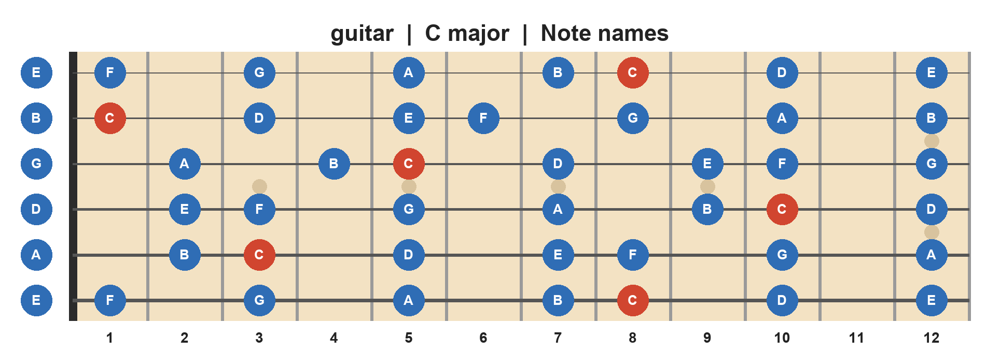
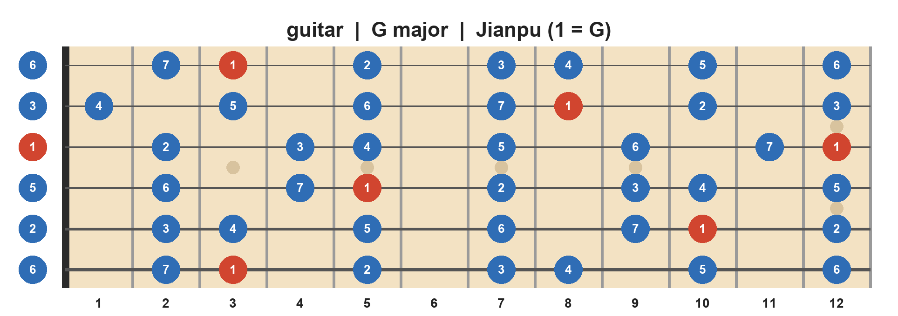
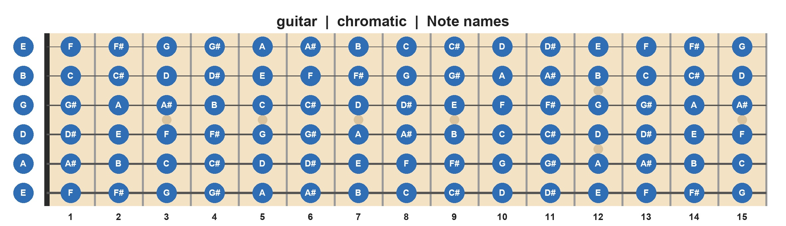
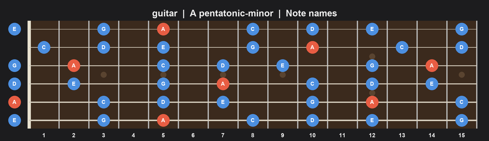
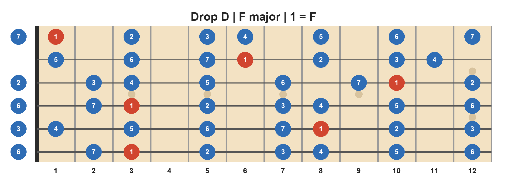
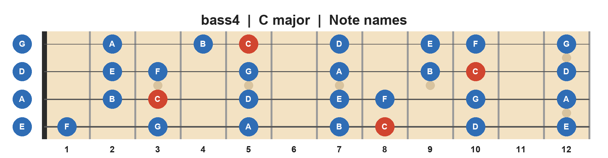
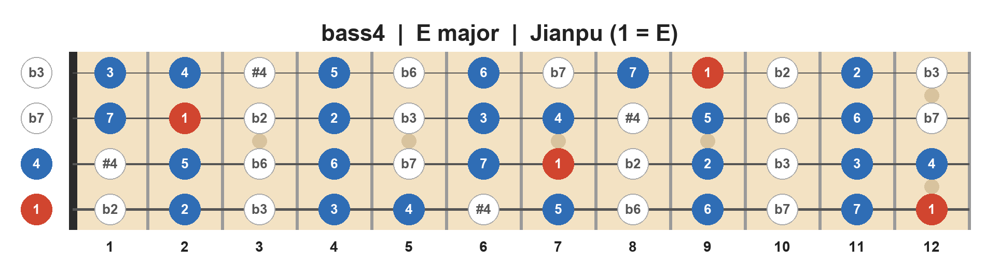
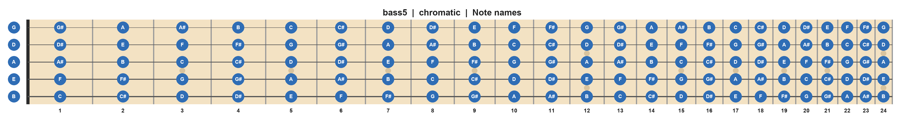
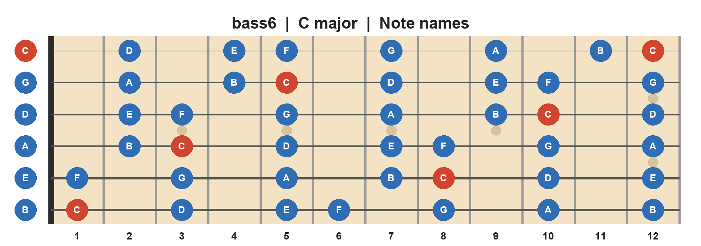

# 吉他 / 貝斯指板圖產生器

用 Python + Pillow 產生吉他、貝斯指板圖（PNG 或 JPG），音符可標成音名（C D E F G A B）或簡譜（1–7，首調唱名）。

## 安裝

```bash
pip install -r requirements.txt   # 只需要 Pillow
```

## 用法

```bash
python fretboard.py -o out.png                                   # 吉他、C 大調、音名
python fretboard.py -l jianpu -k G -o g_jianpu.png               # 簡譜，1 = G
python fretboard.py -i bass4 -l jianpu -k E --show-all -o b.png  # 4 弦貝斯，調外音以空心圓顯示
python fretboard.py -s all -f 15 -o all.jpg                      # 全部 12 個音、15 格、輸出 JPG
python fretboard.py -t "D2 A2 D3 G3 B3 E4" -k D -o dropd.png     # 自訂調弦
```

輸出格式由副檔名決定（`.png` / `.jpg`）。

## 範例

以下圖片都在 [`samples/`](samples/)，用對應的指令產生。

### 吉他 C 大調，音名，主音標紅

```bash
python fretboard.py -o samples/guitar_C_major_notes.png --highlight-root
```



### 吉他 G 大調，簡譜（1 = G）

```bash
python fretboard.py -o samples/guitar_G_major_jianpu.png -l jianpu -k G
```



### 吉他全部 12 個音，15 格，輸出 JPG

```bash
python fretboard.py -o samples/guitar_all_notes_15fret.jpg -s all -f 15
```



### 吉他 A 小調五聲音階，深色主題

```bash
python fretboard.py -o samples/guitar_A_minor_pentatonic_dark.png -s pentatonic-minor -k A -f 15 --highlight-root --theme dark
```



### 吉他 Drop D 調弦，F 大調簡譜，自訂標題

```bash
python fretboard.py -o samples/guitar_dropD_F_major_jianpu.png -l jianpu -k F -t "D2 A2 D3 G3 B3 E4" --title "Drop D | F major | 1 = F"
```



### 4 弦貝斯 C 大調，音名

```bash
python fretboard.py -o samples/bass4_C_major_notes.png -i bass4 -k C -s major --highlight-root
```



### 4 弦貝斯 E 大調簡譜，調外音以空心圓顯示

```bash
python fretboard.py -o samples/bass4_E_major_jianpu_showall.png -i bass4 -l jianpu -k E --show-all
```



### 5 弦貝斯全部音，24 格，真實琴格比例

```bash
python fretboard.py -o samples/bass5_all_notes_24fret_real.png -i bass5 -s all -f 24 --spacing real
```



### 6 弦貝斯 C 大調，音名

```bash
python fretboard.py -o samples/bass6_C_major_notes.png -i bass6 -k C -s major --highlight-root
```



## 參數

| 參數 | 說明 |
|---|---|
| `-i, --instrument` | `guitar`（預設）、`guitar7`、`bass4`、`bass5`、`bass6`、`ukulele` |
| `-t, --tuning` | 自訂調弦，由低音弦到高音弦，例如 `"D2 A2 D3 G3 B3 E4"` |
| `-f, --frets` | 格數（預設 12） |
| `-l, --labels` | `note` 音名、`jianpu` 簡譜、`octave` 含八度（C4） |
| `-k, --key` | 調性 / 主音；簡譜時就是「1」的音（預設 C） |
| `-s, --scale` | `major`（預設）、`minor`、`harmonic-minor`、`melodic-minor`、`pentatonic-major`、`pentatonic-minor`、`blues`、`dorian`、`mixolydian`、`all` |
| `--show-all` | 調外音也畫出來（空心圓） |
| `--accidental` | `sharp` / `flat` / `auto`；簡譜 auto 會用 #4、b3、b6、b7 這類常見寫法 |
| `--highlight-root` | 音名模式也把主音標紅（簡譜模式一律標紅 1） |
| `--spacing` | `equal` 等寬格（預設）或 `real` 真實琴格比例 |
| `--theme` | `light` / `dark` |
| `--lefty` | 左手琴鏡像 |
| `--zoom` | 圖片放大倍率（預設 2） |
| `--title` | 自訂標題；`--title ""` 不顯示標題 |

## 說明

- 圖的方向：琴枕在左，最低音弦在最下面（與 TAB 譜一致）；最左邊一欄是空弦音。
- 簡譜採首調：`-k` 指定的音就是 1。小調用 `-s minor` 時會顯示為 1 2 b3 4 5 b6 b7；若習慣「小調以 6 為主音」的寫法，改用關係大調，例如 A 小調用 `-k C`。
- 圖片內文字只用英數字，避免各系統缺少中文字型。字型會自動找 DejaVu / Arial，找不到時用 Pillow 內建字型。
